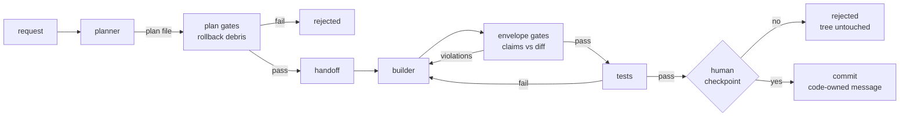

<div align="center">

# 🏭 software factory

**A personal software factory: plan → build → test → review, owned by code.**

*Agent proposes, code disposes.*

<br>


-orange)


</div>

---

Most agentic coding setups hand the loop to the model. This one hands the loop to a
deterministic Python orchestrator and makes the model a **bounded node** inside it:
typed envelopes in, gates on the way out, rollbacks for unauthorized writes, and a
human checkpoint before anything lands in your history.

Inspired by the *shape* of
[disler/super-simple-software-factory](https://github.com/disler/super-simple-software-factory)
(IndyDevDan's video walkthrough) — built from scratch, local-first, on SQLite.

## ▶ Demo

A real feature, end to end — the planner writes a plan file, the builder implements it
inside a gated build→test loop, the human approves, code commits:

```console
$ factory plan-build-test "add a file hello.txt containing exactly: hi" --repo /tmp/demo

run b47b6d3c started (repo=/tmp/demo)
  #1 plan         agent/planner   ..................  pass
  #2 plan_gates   code            ..................  pass   ← unclaimed writes rolled back
  #3 handoff      code            ..................  pass   ← the plan crosses as a file
  #4 commit:plan  git             ..................  pass
  #5 build:r1     agent/builder   ..................  pass
  #6 test:r1      code            ..................  pass
  #7 checkpoint   human           ..................  ⌛     commit these changes? [y/N]

pending changes:
 M README.md
?? hello.txt

commit these changes? [y/N] y
```

And the observability UI — watch any run live, no transcripts:

```console
$ factory ui            →  http://127.0.0.1:8666   (read-only, loopback, refreshes
                                                      every 5s while a run is live)
```

## ⚙️ How it works



- **Contracts, not vibes.** Every agent phase must return a typed pydantic envelope;
  invalid output is corrected in the *same* session (resume by id, never cold-restart).
- **Gates verify, they don't trust.** The builder claims its changed files; any
  unclaimed change is rolled back against a clean baseline. Reviewers score findings
  0–100; **anything ≥50 blocks the commit** and goes to a bounded fix loop.
- **The trace is the ground truth.** Runs, phases, decisions, envelope attempts and
  800+ streaming events per chain land in SQLite (WAL). The UI reads it `query_only` —
  it can watch a live run but provably cannot touch it.

## 🚀 Quickstart

```bash
git clone https://github.com/ricardomm85/software-factory && cd software-factory
uv sync
cp .env.sample .env            # add ZAI_API_KEY (Z.AI coding plan)
uv run factory plan-build-test "add a fibonacci function" --repo ~/Projects/demo
```

That's it — [pi](https://github.com/badlogic/pi-mono) is the coding agent (installed
separately), GLM-5.3-flash is the brain, your repo is the workplace.

## 🧰 The commands

| command | what it does |
|---|---|
| `factory run "<prompt>"` | one agent phase inside a traced run — the spine |
| `factory build-test "<prompt>"` | builder + tests with a bounded fix loop |
| `factory plan-build-test "<prompt>"` | the standard chain: plan → gates → handoff → build/test → **checkpoint** → commit |
| `factory build-review` | multi-lens review of your working tree: 2 lenses → scorer → **gate ≥50 blocks** → fixer rounds |
| `factory ui` | read-only web UI over the trace — live waterfall per phase |
| `factory sessions` / `factory phases <id>` | read the trace from your terminal |
| `factory --repo <path> …` | point any command at another repo — one roster, one trace |

Every chain flag that matters is overridable (`--max-rounds`, `--checkpoint/--no-checkpoint`,
`--lenses`, `--timeout`, `--test-command`); defaults live in [`config.yaml`](config.yaml).

## 📜 Ground rules

1. Config and prompts are **data** (YAML/Markdown), never hardcoded Python.
2. Every phase is born `fail`; success must be **earned** — clean exit + green gates.
3. Bad agent output is corrected **in the same session**; a cold restart throws away
   everything the agent learned.
4. Deterministic code owns sequencing, retries, and acceptance. Agents own the work
   *inside* one bounded phase.
5. A human checkpoint gates the final commit; no TTY attached → the checkpoint refuses
   rather than silently approve itself.
6. The factory's own trace is invisible to reviewers and untouchable by rollbacks.

## 🐕 Dogfooding: the factory reviews itself

This repo is built with its own factory, per the self-hosting ladder in
[`PLAN.md`](PLAN.md) — and it has already paid rent:

- its `build-review` chain is a standing **pre-PR gate**: two review lenses + scorer run
  over every diff before a pull request opens
- on PR #6 it went further than verdicts: the **fixer caught two real bugs** in the
  author's working tree (`prompt` not honoring `--repo`; the UI crashing on legacy
  traces) and landed the fixes *with tests*
- a live smoke test once caught the factory **deleting its own trace** in a target repo
  without a `.gitignore` — the rollback boundary now exempts the trace db by design

## 🗺️ Roadmap

| phase | scope | status |
|---|---|---|
| 0 | agent backend spike (pi + Z.AI) | ✅ |
| 1 | execution spine, envelopes, SQLite trace | ✅ |
| 2 | gates + bounded correction + rollback boundary | ✅ |
| 3 | standard chain, first self-hosted commit | ✅ |
| 4 | multi-lens review + scoring gate ≥50 | ✅ |
| 5 | observability UI + human checkpoints | ✅ |
| 5b | roster/target decoupling (`--repo`) | ✅ |
| 6 | parallelism, branch-per-run, sandboxing | ⬜ next |

## ⚠️ Honest limitations

- **v1 runs on your working tree** — no branch-per-run, no sandbox yet. Mitigated by a
  clean-tree requirement at chain start and rollbacks against that baseline.
- **Sequential by design (so far)** — reviewers and lenses run one at a time; the
  Phase 6 fleet is where fan-out parallelism lands.
- **One provider** (Z.AI/GLM) — the roster names agents, never models, but the provider
  switch is a manual decision, not a config toggle yet.
- **No eval set yet** — quality is gated by prompts + tests + review scores, measured
  against this repo's own history only.

## 📚 Docs

- [`PLAN.md`](PLAN.md) — the decision log: every phase's design note, closure evidence
  and the live-smoke stories (including the bugs the factory caught in itself)
- [`AGENTS.md`](AGENTS.md) — the working conventions any contributor (human or model)
  must follow

## 🙏 Credits

- [disler/super-simple-software-factory](https://github.com/disler/super-simple-software-factory)
  & [IndyDevDan's walkthrough](https://www.youtube.com/watch?v=haUfb1ievTE) — the shape
- [pi coding agent](https://github.com/badlogic/pi-mono) — the bounded node
- [Z.AI](https://z.ai) — GLM-5.3-flash, the brain

---

<div align="center">
<sub>built with itself, one gated phase at a time · <em>agent proposes, code disposes</em></sub>
</div>
